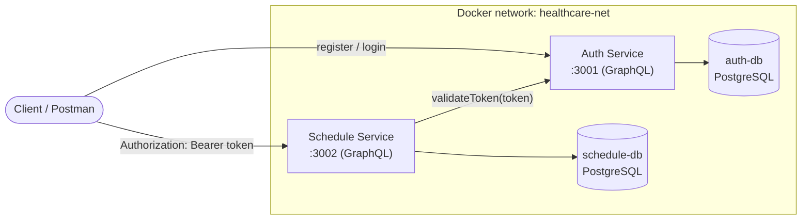

# Healthcare Scheduling System

Microservice backend untuk mengelola jadwal konsultasi antara dokter dan pasien (RATA Skill Test – Backend Engineer).

| Komponen | Teknologi |
| --- | --- |
| Framework | NestJS 10 |
| API | GraphQL (code-first, Apollo) |
| Database | PostgreSQL 16 (satu instance per service) |
| ORM | Prisma 5 |
| Auth | JWT + bcrypt |
| Container | Docker & Docker Compose |

## Arsitektur



```
Client ──register/login──────────────▶ Auth Service (3001) ──▶ auth-db
Client ──Bearer <JWT>──▶ Schedule Service (3002) ──▶ schedule-db
                              │
                              └── validateToken(token) ──▶ Auth Service
```

Prinsip desain:

- **Database per service.** Tidak ada tabel atau foreign key lintas service, jadi keduanya bisa di-deploy dan di-scale terpisah.
- **Auth terpusat.** Schedule Service tidak pernah memegang `JWT_SECRET`. Setiap request divalidasi lewat query `validateToken` ke Auth Service (global `GqlAuthGuard`), sehingga rotasi secret atau pencabutan user langsung berlaku.
- **Fail-safe.** Token tidak ada / salah → `Unauthorized`. Auth Service tidak bisa dijangkau → `503 Service Unavailable` (bukan lolos diam-diam).
- **Anti jadwal bentrok di dua lapis.** Pengecekan di service layer (pesan error jelas) **dan** unique index `(doctorId, scheduledAt)` di database sebagai pengaman untuk race condition.

## Menjalankan project

Prasyarat: Docker dan Docker Compose.

```bash
cp .env.example .env
# isi JWT_SECRET dan password database di .env, contoh: openssl rand -hex 32
docker compose up --build
```

- Auth Service: <http://localhost:3001/graphql>
- Schedule Service: <http://localhost:3002/graphql>

Migrasi database dijalankan otomatis saat container start (`prisma migrate deploy`). Kedua endpoint membuka GraphQL Playground di browser, tempat deskripsi tiap query/mutation bisa dibaca dari tab Docs/Schema.

### Menjalankan tanpa Docker (development)

```bash
# terminal 1
cd auth-service && cp .env.example .env && npm install
npx prisma migrate dev && npm run start:dev

# terminal 2
cd schedule-service && cp .env.example .env && npm install
npx prisma migrate dev && npm run start:dev
```

Butuh dua database PostgreSQL lokal sesuai `DATABASE_URL` di masing-masing `.env`.

### Unit test

```bash
cd auth-service && npm test -- --coverage
cd schedule-service && npm test -- --coverage
```

Schedule Service juga punya smoke test GraphQL (`app.e2e.spec.ts`) yang mem-boot seluruh aplikasi dengan Prisma dan Auth Service di-mock, untuk memastikan schema valid, guard aktif, dan validasi input bekerja.

## Environment variables

File `.env` di root dipakai oleh `docker-compose.yml`. Tidak ada secret yang di-commit; `.env` ada di `.gitignore`.

| Variable | Dipakai oleh | Default | Keterangan |
| --- | --- | --- | --- |
| `JWT_SECRET` | auth | **wajib** | Secret penandatangan JWT |
| `JWT_EXPIRES_IN` | auth | `1h` | Masa berlaku access token |
| `BCRYPT_SALT_ROUNDS` | auth | `10` | Cost factor bcrypt |
| `AUTH_PORT` | compose | `3001` | Port host Auth Service |
| `AUTH_DB_USER` / `AUTH_DB_PASSWORD` / `AUTH_DB_NAME` | auth-db | `postgres` / **wajib** / `auth_db` | Kredensial database auth |
| `SCHEDULE_PORT` | compose | `3002` | Port host Schedule Service |
| `SCHEDULE_DB_USER` / `SCHEDULE_DB_PASSWORD` / `SCHEDULE_DB_NAME` | schedule-db | `postgres` / **wajib** / `schedule_db` | Kredensial database schedule |

Variable yang di-set compose langsung ke container (lihat `.env.example` di tiap service untuk mode non-Docker):

| Variable | Service | Keterangan |
| --- | --- | --- |
| `PORT` | keduanya | Port aplikasi di dalam container |
| `DATABASE_URL` | keduanya | Connection string Prisma |
| `AUTH_SERVICE_URL` | schedule | URL GraphQL Auth Service (`http://auth-service:3001/graphql` di Docker network) |

## Contoh GraphQL

### Auth Service (`:3001/graphql`)

```graphql
mutation {
  register(input: { email: "user@example.com", password: "password123" }) {
    id
    email
  }
}

mutation {
  login(input: { email: "user@example.com", password: "password123" }) {
    accessToken
    user { id email }
  }
}

query {
  validateToken(token: "<accessToken>") { id email }
}
```

### Schedule Service (`:3002/graphql`)

Semua request wajib memakai header `Authorization: Bearer <accessToken>`.

```graphql
mutation {
  createCustomer(input: { name: "Budi Santoso", email: "budi@example.com" }) { id }
}

mutation {
  createDoctor(input: { name: "dr. Siti Rahma" }) { id }
}

mutation {
  createSchedule(input: {
    objective: "Medical check-up"
    customerId: "<customerId>"
    doctorId: "<doctorId>"
    scheduledAt: "2026-12-01T09:00:00Z"
  }) {
    id
    scheduledAt
    customer { name }
    doctor { name }
  }
}

query {
  schedules(page: 1, limit: 10, doctorId: "<doctorId>",
            from: "2026-12-01T00:00:00Z", to: "2026-12-31T23:59:59Z") {
    total
    totalPages
    items { id objective scheduledAt customer { name } doctor { name } }
  }
}

query { customers(page: 1, limit: 10) { total items { id name email } } }
query { doctors(page: 1, limit: 10) { total items { id name } } }
```

CRUD lengkap (`update*`, `delete*`, `customer(id)`, `doctor(id)`, `schedule(id)`) tersedia di Postman collection.

Postman: import `healthcare-scheduling.postman_collection.json`. Request `login` otomatis menyimpan token, dan request create menyimpan ID untuk request berikutnya.

## Aturan bisnis & penanganan error

| Kasus | Respons |
| --- | --- |
| Header token tidak ada / salah / kedaluwarsa | `Unauthorized` |
| Auth Service tidak dapat dijangkau | `Service Unavailable` |
| Email sudah terdaftar (user / customer) | `Conflict` |
| Customer / doctor / schedule tidak ditemukan | `Not Found` |
| Dokter yang sama sudah punya jadwal di `scheduledAt` yang sama | `Conflict` |
| Menghapus customer / doctor yang masih punya schedule | `Conflict` (FK `Restrict`) |
| Input tidak valid (email, UUID, `limit` > 100, dst.) | `Bad Request` |

Catatan keputusan:

- "Bentrok" didefinisikan sebagai **dokter yang sama pada timestamp yang sama persis** (sesuai soal). Durasi slot tidak dimodelkan; jika dibutuhkan, tinggal tambah `durationMinutes` dan ganti pengecekan menjadi overlap range.
- Pesan login sama untuk email tidak dikenal dan password salah, agar tidak membuka user enumeration.
- Email dinormalisasi ke huruf kecil. Password hash tidak pernah ada di schema GraphQL.
- List selalu paginated (`page` default 1, `limit` default 10, maksimum 100) dan mengembalikan `total` serta `totalPages`.

## Struktur project

```
healthcare-scheduling/
├── docker-compose.yml
├── .env.example
├── README.md
├── healthcare-scheduling.postman_collection.json
├── auth-service/
│   ├── Dockerfile
│   ├── prisma/            # schema + migrations
│   └── src/
│       ├── auth/          # resolver, service, DTO, model
│       └── prisma/
└── schedule-service/
    ├── Dockerfile
    ├── prisma/
    └── src/
        ├── auth/          # AuthClientService + global GqlAuthGuard
        ├── common/        # pagination helpers
        ├── customer/
        ├── doctor/
        ├── schedule/
        └── prisma/
```

## Bonus

| Fitur | Status |
| --- | --- |
| Unit testing ≥ 50% coverage | Ya (Schedule Service ± 95%, Auth Service > 60%) |
| GraphQL Playground dengan deskripsi | Ya (Playground aktif, semua field/operasi punya description) |
| Email notification, Bull queue, Redis cache | Belum dikerjakan |
